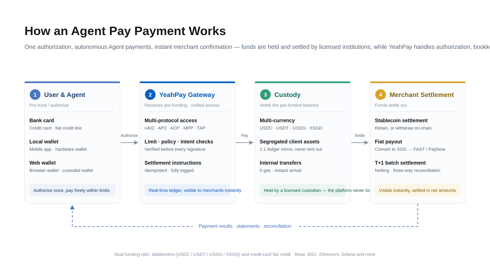
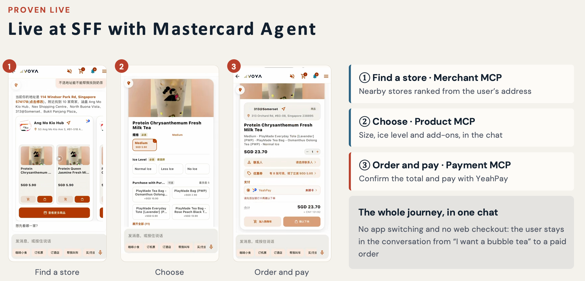
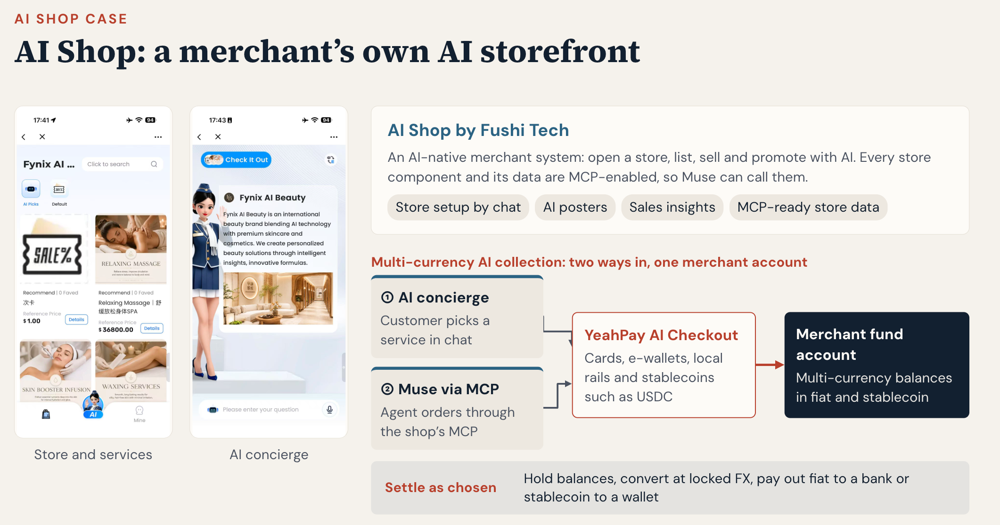

- **文档类型** 产品介绍（Product Overview）
- **版本** V1.0
- **适用对象** 商户 · Agent 平台 · API 服务商 · 渠道合作机构
- **覆盖协议** AP2 · ACP · UCP · x402 · MPP · Visa TAP · Mastercard Agent Pay
- **资金托管** 持牌 web3 钱包托管机构；法币轨道经卡组机构授权与清算

## 1. 产品介绍

Agent Pay 是面向 AI Agent 时代的支付与记账中间层：用户通过 Web3 钱包完成一次预授权（或经法币卡组机构以信用卡授权法币支付额度），AI Agent 即可在授权额度内自主完成支付；YeahPay 中心化记账、实时确认，持牌 web3 钱包托管机构完成稳定币资金托管与最终结算。

它解决 Agent 支付的三个根本问题：

| 问题 | Agent Pay 的答案 |
| --- | --- |
| 每笔支付都要用户在场签名 | 一次预授权，N 次免签扣款：额度、期限、商户范围、单笔上限全部可控，可随时撤销 |
| AP2 / ACP / x402 等协议碎片化 | 一套 API 聚合七协议：AP2 · ACP · UCP · x402 · MPP · Visa TAP · Mastercard Agent Pay，统一收敛为平台支付意图 |
| 微支付逐笔上链成本高于本金 | 链下高频记账 + 链上净额结算：$0.01 级支付在经济学上成立 |

### 核心能力

- **双资金入口**（稳定币预充值 + 信用卡法币额度授权）
- **多链多币**（USDC / USDT / USDG / XSGD，覆盖 Base、BSC、Ethereum、Solana 等）
- **智能体安全**（KYA 准入 + Intent Guard 意图识别）
- **商户收款钱包双模式**（默认托管开通，可选绑定自有 Web3 钱包）
- **全量行为留痕**，支撑对账审计与商户精准营销。

### 两条产品线

- Agent Pay-in（机器客户收单）：API / MCP / 内容与算力服务商一次接入，即可接受具备支付能力的 Agent 客户。
- Agent Pay-out（机器代理支付）：企业授权 Agent 在限定额度与规则内自主采购，保留审计与对账能力。

## 2. 业务价值

| 对象 | 核心价值 |
| --- | --- |
| 用户 | 一次授权，长期免签；稳定币额度或信用卡法币额度均可，可控、可查、可随时撤销 |
| Agent / 平台方 | 一套 API 接入七协议，专注业务，不必理解各协议差异 |
| 商户 | 稳定币即时确认、T+1 净额结算；法币卡轨道经卡组清算入账；留存稳定币或法币出金自由选择 |
| 企业客户 | Agent 自主采购可控可审计；全量行为留痕沉淀为用户洞察与精准营销 |

一句话：把卡组织成熟的「授权—清算—结算」三段式，用稳定币和钱包签名重新实现一遍，并让卡轨道与稳定币轨道共用同一套授权与记账——授权链下高频发生，结算批量落地。

## 3. 资金流程

一笔 Agent 支付经过四个环节——用户只需在第 ① 步出现一次，之后从支付到结算全自动完成：

<Frame caption="Agent Pay 如何完成一笔支付">
  
</Frame>

| 环节 | 谁来做 | 发生什么 |
| --- | --- | --- |
| ① 用户与 Agent（一次） | 用户 | 选择付款方式——用户卡组（信用卡 · 法币额度）、本地钱包（手机 App · 硬件钱包）或 Web 钱包（浏览器 · 托管钱包）；设定额度、有效期、商户范围，完成一次授权 |
| ② YeahPay 网关（每笔） | 平台 | 接收 Agent 支付请求：多协议接入（x402 · AP2 · ACP · MPP · TAP），校验额度、策略与意图一致性，通过后签发结算指令、账本实时记账 |
| ③ 资金托管（每笔） | 持牌托管机构 | 托管用户各币种预充值（USDC / USDT / USDG / XSGD）；客户资产隔离、1:1 账本镜像；内部划转 0 gas、秒级到账，商户即时可见 |
| ④ 商户结算（T+1） | 平台 + 托管机构 | 净额轧差后结算：留存稳定币 / 链上提币 / 兑换 SGD 法币出金；支付结果、账单与对账明细回传用户与商户 |

三条底线：资金由持牌机构隔离保管，YeahPay 任何时刻不碰资金；高频支付全部链下记账，链上只发生在充值与出金两个边界；每一笔授权、支付、退款全程留痕，随时可查。

## 4. 接入说明

接入方式：

| 方式 | 适用对象 | 内容 |
| --- | --- | --- |
| 商户 API / SDK | 电商、SaaS、线下门店 | 支付、退款、对账、Webhook 回调 |
| 协议网关 | API / MCP / 算力服务商 | 一次接入 x402 等协议，接受 Agent 机器客户付款 |
| 卡组织通道 | 需接受信用卡付款的商户 | 法币卡轨道：经法币卡组机构完成信用卡授权与清算（Visa TAP / Mastercard Agent Pay） |
| Agent 接入 | Agent 平台、企业自动化 | 钱包开通、预授权管理、支付执行、账单归集 |
| 洞察订阅 | 有营销需求的商户 | 行为事件流、聚合报表（T+1）与实时 Webhook |

接入前准备：主体资质文件、结算账户（默认开通托管钱包，或绑定自有 Web3 钱包；如需法币卡轨道另需完成卡收单配置）、商品或服务目录、回调地址；沙箱环境与联调支持由平台提供。

典型周期：沙箱接入 3～5 个工作日，生产上线 2～4 周（视合规审核进度）。

费率、结算周期、额度与合同条款等具体接入细节，请联系 YeahPay 商务团队。

<Frame caption="附图1：MasterCard Agent合作案例">
  
</Frame>

<Frame caption="附图2：Fushi — AI SHOP合作案例">
  
</Frame>

## 5. 常见问题 FAQ

<AccordionGroup>
  <Accordion title="Q1：什么是「一次授权、长期免签」？我需要每笔都签字吗？">
    不需要。首次使用时通过钱包签名（或信用卡授权）设定支付额度、有效期、商户范围与单笔上限，此后额度内的支付由 Agent 自动完成，所有记录实时可查。
  </Accordion>
  <Accordion title="Q2：我的资金放在哪里？安全吗？">
    存放在持牌 web3 钱包托管机构的客户隔离账户，与平台自有资金完全隔离、不得挪用；YeahPay 账本与托管余额 1:1 对应、可随时穿透验证。
  </Accordion>
  <Accordion title="Q3：Agent 会不会乱花钱？">
    三重防线：额度硬上限（超出即拒）→ KYA 智能体准入（对 Agent 主体与权限的审查）→ Intent Guard 意图校验（每笔支付核对实际参数与授权意图是否一致）。异常支付会被拦截或转用户二次确认，而非直接执行。
  </Accordion>
  <Accordion title="Q4：支持哪些币种和链？">
    USDC / USDT / USDG / XSGD，覆盖 Base、BSC、Ethereum、Solana 等链。以 USD 计价，可任选币种支付，锁价窗口内汇率透明。
  </Accordion>
  <Accordion title="Q5：我没有稳定币，可以用信用卡吗？">
    可以。信用卡经法币卡组机构授权支付额度后即可作为付款方式，与稳定币额度共用同一套授权与账单。
  </Accordion>
  <Accordion title="Q6：如何撤销授权？">
    随时在 App / 后台一键撤销，链上即时生效；撤销后 Agent 无法再发起任何扣款，已授权未消费的余额可原路退回。
  </Accordion>
  <Accordion title="Q7：商户多久能收到钱？">
    支付确认即时到账可见；资金结算默认 T+1 净额轧差。商户可选择留存稳定币、链上提币，或兑换 SGD 经 FAST / PayNow 法币出金。
  </Accordion>
  <Accordion title="Q8：退款和争议怎么处理？">
    支持原路退款。争议期间相关金额冻结、该商户结算暂停，由平台按服务条款裁定，处理过程与结果全程留痕。
  </Accordion>
  <Accordion title="Q9：我的支付数据会被拿去做营销吗？">
    营销用途需要单独授权，与支付授权分离、可随时撤回；对商户只输出去标识化的聚合洞察，不做跨商户身份串联，遵守 PDPA 等数据保护法规。
  </Accordion>
  <Accordion title="Q10：开始使用需要多久？">
    用户侧：完成一次授权即可使用。商户侧：沙箱接入 3～5 个工作日，生产上线 2～4 周。费率、额度与结算周期等商务条款请联系 YeahPay 商务团队。
  </Accordion>
</AccordionGroup>
