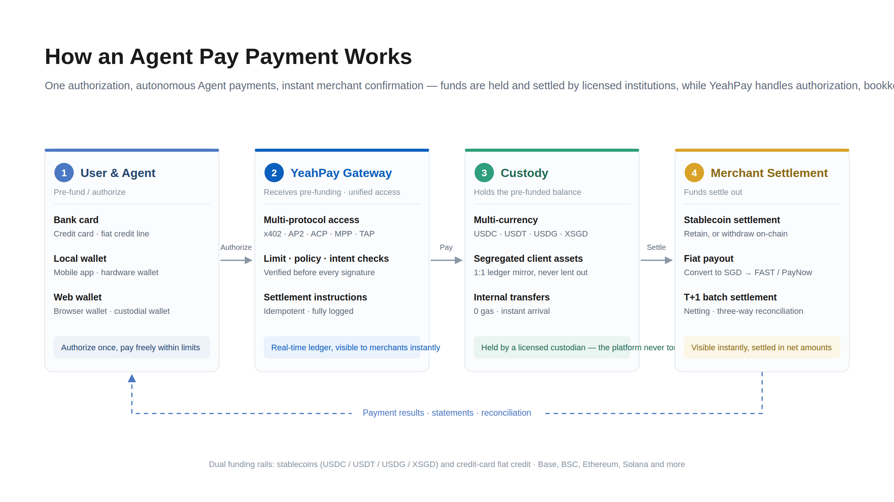

**YEAHPAY  AGENTPAY**

Product Brief

## Accept payments from AI Agents

**Your customers are becoming AI Agents.** Agents book, buy and pay on behalf of users — automatically, inside chatbots and apps. Agent Pay lets your business accept those payments with one integration: no account sign-ups, no card flows, no subscription plumbing.

**Authorize once — your AI Agent pays automatically within your limits.** Funds are held by a licensed custodian; merchants settle daily.

## Who it's for

| Customer | What they get |
| --- | --- |
| **API, MCP & compute providers** | Sell to machine customers — paid per call, no subscriptions needed |
| **Merchants & brands** | Accept payments inside chatbots, apps and AI shopping flows |
| **Digital services & content** | Paywalls that AI Agents can actually pay at |
| **Agent platforms & enterprises** | Let your Agents pay for tools and services autonomously, with full audit |

## Typical use cases

### Primary — AI Agents pay you (collect)

- A travel Agent books and pays for a hotel room inside the chat — you get paid, the user never opens a checkout page
- An Agent buys data, search or model inference per call — every call becomes revenue
- A shopping Agent checks out at your store on the user's behalf

### Secondary — your own Agents pay out (spend)

- An enterprise Agent pays for approved tools and services within its budget, with a full audit trail

## Contact

> **For pricing, onboarding and any details — ask your YeahPay business manager.**
