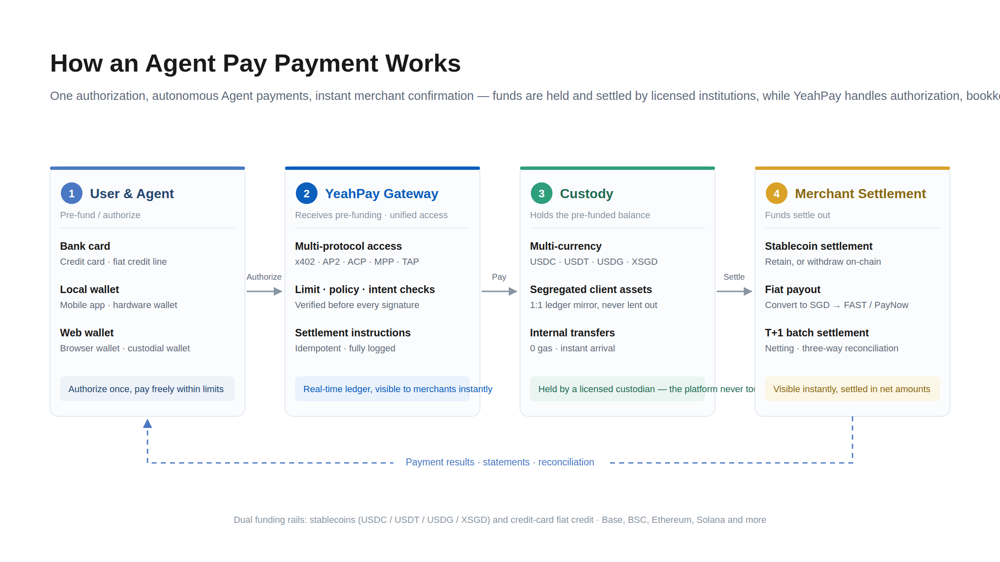

**YEAHPAY  AGENTPAY**

產品簡介

## 接受 AI 智能體付款

**AI 智能體正在成為您的客戶。** 智能體可在聊天機器人和應用中自動代用戶預訂、購買和付款。Agent Pay 讓您的企業一次接入即可接受這些付款，無需註冊賬戶、走銀行卡支付流程或搭建訂閱系統。

**只需授權一次，您的 AI 智能體即可在您設定的限額內自動付款。** 資金由持牌託管機構保管，商戶每日結算。

## 適用對象

| 客戶 | 可獲得的能力 |
| --- | --- |
| **API、MCP 和算力服務提供商** | 向機器客戶提供服務，按調用收費，無需訂閱 |
| **商戶和品牌** | 在聊天機器人、應用和 AI 購物流程中收款 |
| **數字服務和內容提供商** | 付費牆支持 AI 智能體直接付款 |
| **智能體平台和企業** | 讓您的智能體自主為工具和服務付款，支持完整審計 |

## 典型使用場景

### 主要場景：AI 智能體向您付款（收款）

- 旅行智能體在聊天中預訂酒店客房並付款。您收到款項，用戶無需打開收銀台頁面
- 智能體按次購買數據、搜索或模型推理服務，每次調用都帶來收入
- 購物智能體代表用戶在您的商店結賬

### 次要場景：您的智能體對外付款（支出）

- 企業智能體在預算內為已獲批准的工具和服務付款，保留完整審計記錄

## 聯繫我們

> **如需瞭解費率、接入流程或其他詳情，請聯繫您的 YeahPay 客戶經理。**
